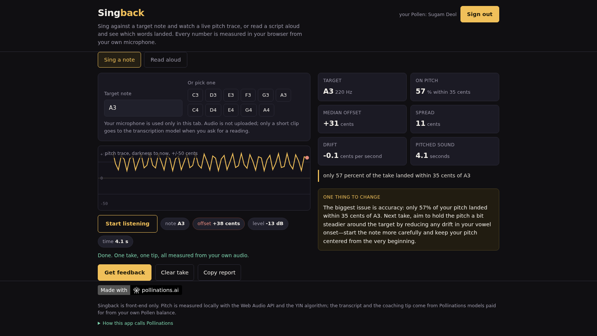

# Singback

Practise singing or speaking and get feedback you can check.

[](https://pollinations.ai/?ref=badge)

**Live app:** https://sugamdeol.github.io/singback/



Two modes, one idea: measure the take in the browser, then ask a model for the
single thing to change next.

- **Sing a note.** Pick a target note, sing into the microphone, and watch a
  live pitch trace. When you stop, the app reports the share of the take that
  landed within 35 cents, the median offset, the spread, and the drift in cents
  per second.
- **Read aloud.** Paste a script, read it, and the app aligns what you said
  against what you meant to say, word by word. It reports coverage, the words
  missed, the words added, and highlights both.

Pitch is measured locally with the Web Audio API. Nothing is uploaded for the
pitch reading. The recorded clip is sent to a Pollinations transcription model
only when you press **Get feedback**, and the numbers plus the transcript go to
a text model for one coaching line.

## How this app calls Pollinations

Sign-in is the Pollinations OAuth code flow with PKCE, so there is no key to
paste and the token stays in the tab's `sessionStorage`. The app requests the
`audio` and `text` model scopes with a 3 dollar budget and a 7 day expiry, and
the visitor's own balance pays.

A take makes two calls:

```
POST https://gen.pollinations.ai/v1/audio/transcriptions
  model=openai/whisper-large-v3        (audio in, text out)

POST https://gen.pollinations.ai/v1/chat/completions
  model=openai/gpt-5.4-nano            (the coaching line)
```

Both model ids are listed by `https://gen.pollinations.ai/v1/models` with
`paid_only: false`, so a take costs a fraction of a Pollen from the visitor's
own balance.

The code, if you want to check it:

- `core.js` - pitch detection (YIN), take statistics, script alignment. Pure
  functions, no DOM and no network.
- `app.js` - microphone capture, the pitch trace, the two Pollinations calls.
- `core.test.js` - 27 tests over the measurement logic.

## Run it

There is no build step and no dependencies. Serve the folder:

```sh
python3 -m http.server 8000
```

Then open <http://127.0.0.1:8000/>. The microphone needs a secure context, so
`localhost` or HTTPS; a plain `file://` page will not get one.

```sh
node --test core.test.js
```

## Notes on the measurement

- Pitch uses YIN's cumulative-mean-normalised difference function. Plain
  autocorrelation returns 110 Hz for a clean 440 Hz tone, because four periods
  correlate as well as one; YIN's minimum sits at the true period.
- Frames below 0.008 RMS or under 0.6 clarity are dropped, so a breath or a
  hiss does not become a note.
- "In tune" is 35 cents either side of the target. That is wide enough to allow
  a little vibrato and narrow enough that a wrong note cannot pass.
- Script alignment is a longest-common-subsequence over lowercased words, so a
  misheard word shows up as one miss and one addition instead of shifting every
  later word.
